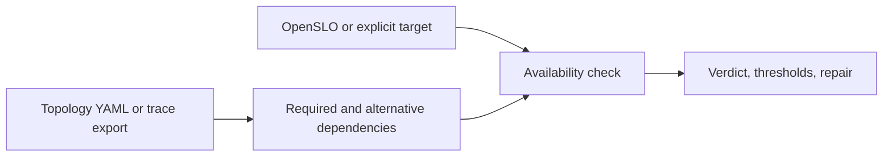

# slacheck

slacheck helps SREs check whether a service dependency graph can meet an availability objective and find the smallest service change that would meet it.


```sh
git clone --branch showcase/2026-11 https://github.com/Wassbdr/slcmca && cd slcmca
python -m venv .venv && .venv/bin/python -m pip install .
.venv/bin/slacheck check examples/shop.yaml --independent --slo 99.94
```

### Results

In 72 seeded synthetic graphs, slacheck found all 34 infeasible commitments and matched all 712 conditional thresholds. Both 200-service CLI cases took under 1 second on an Intel Xeon x86-64 CPU, Python 3.10, without a GPU. Reproduce with `make bench`; see the [reference versions, seeds](benchmarks/README.md), and [full results](benchmarks/results.md).

| Method | Infeasible found | Precision | Exact thresholds |
| --- | ---: | ---: | ---: |
| slacheck independent | **34/34** | **34/34** | **712/712** |
| Hand error-budget worksheet | 34/34 | 34/38 | Not computed |
| slacheck paper v2 | 29/34 | 29/37 | 0/712 |
| Sloth | 0/34 | N/A | Not computed |
| Pyrra | 0/34 | N/A | Not computed |
| OpenSLO oslo | 0/34 | N/A | Not computed |

Sloth, Pyrra and oslo accepted the reference manifests. These validate objectives
or generate rules; their manifests do not express dependency success conditions.



### Use your own data

- Follow the [tutorial](docs/tutorial.md) for local availability measurements,
  graphs built from OTLP, Jaeger or Tempo, and a CI workflow.
- Try the [three worked examples](docs/examples.md): an infeasible shop
  commitment, an OpenSLO objective and an imported trace.
- Use `--format json` to consume a result in code or `--format sarif` for code
  scanning. The [composite action](action.yml) writes SARIF and fails infeasible
  changes. See the [example workflow](examples/workflows/availability.yml).
- Supply `--improvement-costs costs.yaml` to rank single-service repairs by
  linear cost per percentage point. With no cost file, ranking uses the
  smallest availability increase.

Exit 0 means feasible, 1 means infeasible, and 2 means invalid input.
`--independent` only checks availability. Paper v2 remains the default for
compatibility and safety margins; `--paper-version v1` selects the v1 baseline.
See [architecture](docs/architecture.md) for the differences.

### Development and paper results

```sh
python -m pip install -e '.[dev,docs]'
make check docs
make eval
```

The ISSRE 2026 paper evaluations remain available. `make eval` reproduces
67/113 detections for paper v1 and 113/113 for paper v2.
`python scripts/realistic_study.py` reproduces 8/200 (4.0%) and 179/200 (89.5%)
on a separate synthetic population. These are injected-fault results, not
production false-alarm rates. See the [paper mapping](docs/paper_mapping.md)
and the [Datadog integration reference](docs/datadog_api_catalog.md).

To rebuild the media and metadata, put VHS 0.10, ttyd 1.7, FFmpeg, and the
[benchmark binaries](benchmarks/README.md) on PATH, install DejaVu Sans Mono,
and run `make showcase`.

### Roadmap and known limitations

- Availability is exact under the declared Boolean dependency rules and
  independent states for distinct services. Model known common failure
  domains explicitly; a topology does not establish independence.
- Trace sampling can omit edges. Verify the imported graph and supply measured
  local service availability. Imports do not infer redundancy.
- The repair ranking changes one service at a time. Joint repair budgets and
  non-linear prices are not modeled.
- The independent checker stops on cycles and scopes that exceed its
  decision diagram limits. Split commitments by entrypoint when possible.
