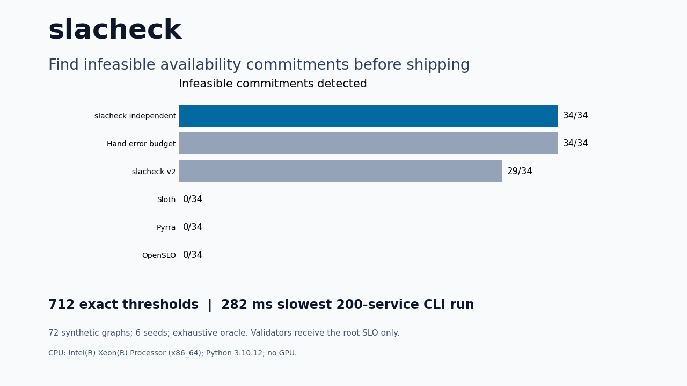
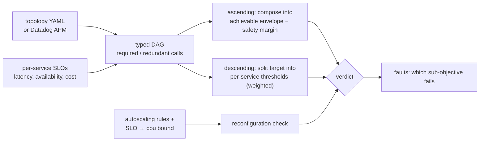

# slacheck

`slacheck` tells SREs and architects which SLO a distributed application can actually promise,
given its service topology and per-service SLOs, and which sub-objective breaks a target such as 99.9%.


```bash
git clone https://github.com/Wassbdr/slcmca && cd slcmca && pip install .
slacheck eval --both                              # 113 injected faults: v1 baseline vs v2
slacheck check examples/shop.yaml --slo 99.9      # your own topology (edit the YAML, re-run)
```

## Key results

Computed by the commands below on an Intel Xeon (8 vCPU, CPU only, Python 3.10); regenerate all of
them, plus the poster and the demo, with `bash showcase/make_showcase.sh`.

| Scenario class (injected faults) | v1 baseline | v2 full method | Command |
|---|---:|---:|---|
| Global-SLO: target above the achievable envelope | 10/10 | 10/10 | `slacheck eval --both` |
| Sub-SLO: one component too weak for its share | 57/60 | **60/60** | `slacheck eval --both` |
| Reconfiguration: unsafe autoscaling rule | 0/43 | **43/43** | `slacheck eval --both` |
| **Total, 113 constructed scenarios** | **67/113** | **113/113** | `slacheck eval --both` |
| Sub-SLO faults on 200 synthetic topologies | 4.0% (8/200) | **89.5% (179/200)** | `python scripts/realistic_study.py` |

Setup: `fixtures/eval` is a constructed, deterministic dataset (`scripts/gen_eval.py`) with one
injected fault per scenario; v1 has no reconfiguration model, so its 0/43 is by construction.
The 200 topologies follow Alibaba-like distributions with a fixed seed
(`scripts/gen_realistic_eval.py 200`); the rates have Wilson 95% CIs [2.0, 7.7] and [84.5, 93.0].
Both datasets inject faults: they show the mechanism, not a false-alarm rate on a real fleet.



## How it works



- **v1 (baseline)** reduces the DAG to one critical series path and splits the target uniformly.
- **v2 (full method)** aggregates the whole typed DAG (redundant branches compose as products),
  subtracts a cloud-tier margin, weights each service's share by its structural centrality, and
  checks autoscaling triggers against the operational bound that keeps the SLO.

## Check your own topology

[`examples/shop.yaml`](examples/shop.yaml) is a 7-service shop (frontend, catalog, cart, checkout,
a third-party payment provider, a redundant database pair) with one autoscaling rule:

```console
$ slacheck check examples/shop.yaml --slo 99.9
...
OVER-COMMITMENT FAULTS (2):
  [ascending/availability] Target availability 99.9% exceeds the achievable envelope 99.855% (error budgets compose).
  [descending/availability] payment: availability 99.95% below required 99.9846%.
$ slacheck check examples/shop.yaml --slo 99.5       # reachable: exit code 0
```

Edit any service's numbers, add edges, or change the autoscaler trigger (try `trigger_value: 85.0`)
and re-run. `--both` prints v1 and v2 one after the other; `--max-latency-ms` and
`--max-cost-eur-h` add latency and cost targets. The exit code is 1 when the check finds a fault,
so the command can gate a CI job. Any file in `fixtures/eval/` uses the same format.

## Details

This is the artifact for the ISSRE 2026 industry-track paper *"What SLA Can I Commit To? Computing
Achievable Service-Level Objectives for Multi-Cloud Applications"*. `slacheck` validates an SLA
either on a hand-written YAML topology or by building the topology **automatically from Datadog**
(validated end-to-end on the `train-ticket` benchmark), and presents the result back inside Datadog.

### Datadog pipeline
```
Datadog APM ──topology──┐
                        ├─► nx.DiGraph ─► critical path ─► envelope ─► verdict ─► Datadog dashboard
Datadog Metrics ─SLOs───┘     (graph/)    (graph/)         (envelope/)            (dashboard/)
```

- **Ascending aggregation** (paper §III-B): combine per-component Sub-SLOs into the guaranteeable
  global envelope: `max` latency, `sum` cost, error-budget composition for availability.
- **Descending decomposition** (§III-C): split a target Global-SLO into per-component thresholds.
- **Critical path**: the DAG is reduced to a single **series path** (max-latency or
  min-availability chain) so the paper's series-only operators apply legitimately.

### Development install (offline, no Datadog keys needed)

```bash
python -m venv .venv && source .venv/bin/activate
pip install -e ".[dev]"
pytest                      # paper's numbers are the regression contract
slacheck analyze --source fixture --entrypoint ts-gateway-service --constraint availability
```

### Live mode (requires keys, see docs/datadog_api_catalog.md)

```bash
cp .env.example .env        # fill DD_API_KEY / DD_APP_KEY / DD_SITE / DD_ENV
pip install -e ".[dev,datadog]"
slacheck catalog            # what data Datadog exposes (also a static doc in docs/)
slacheck record             # capture real API responses into fixtures/datadog/
slacheck analyze --source live --entrypoint ts-gateway-service --constraint latency
slacheck publish --source live --entrypoint ts-gateway-service --constraint latency
```

### Reproducing the empirical evaluation

Everything in `issre_paper.tex` is reproducible **offline**, no credentials. One command runs the
whole thing (datasets → tables → figures) and echoes each paper claim next to the code's output:

```bash
python scripts/reproduce_paper.py     # or: make reproduce
make eval                             # just Table I (tab:eval) as paste-ready LaTeX
```

The individual levels, if you want them one at a time:

```bash
# 1. Real-world case study: train-ticket (38 services), v1 vs v2:
python scripts/case_study.py          # v2: 6 faults / env 98.36%; v1: 3 / 99.40%; latency false-negative
slacheck analyze --source declared --topology fixtures/topology/train-ticket.yaml \
  --metrics-from fixture --paper-version v2 -e ts-ui-dashboard -c availability \
  --min-availability-pct 99.9 --pricing fixtures/scenarios/pricing.example.yaml

# 2. Multiple real systems: train-ticket + Online Boutique (call graph from the GCP manifest):
python scripts/multi_system_study.py  # emits Table tab:realsystems

# 3. Statistical validation: 200 realistic topologies (Alibaba-like distributions, fixed seed):
python scripts/gen_realistic_eval.py 200   # (re)generate the dataset (deterministic)
python scripts/realistic_study.py          # v2 89.5% vs v1 4.0% [Wilson 95% CI], Table tab:realistic
```

Tests lock these numbers: `tests/test_case_study.py` (real systems) and
`tests/test_realistic_study.py` (population). The live Datadog path (real APM topology, provenance
only) is documented in [fixtures/datadog_live/README.md](fixtures/datadog_live/README.md).

### Docs

- [docs/datadog_api_catalog.md](docs/datadog_api_catalog.md): **start here**, what Datadog exposes,
  the exact API calls, metric→SLO conversions, and known gaps.
- [docs/paper_mapping.md](docs/paper_mapping.md): paper section to code module mapping.
- [docs/live_unblock.md](docs/live_unblock.md): runbook for pointing the live path at another org.

## Roadmap and known limitations

- The 113 scenarios are constructed with one injected fault each; they show the mechanism, not
  the false-alarm rate on a production fleet. A labelled incident dataset is the missing piece.
- v1 has no reconfiguration model, so the 0/43 on that class is structural, not measured.
- Datadog exposes no per-service cost; cost comes from a YAML override or a k8s resource estimate.
- Live mode needs Datadog API and app keys; nothing in the showcase or the tests calls it.
- `slacheck eval` and `slacheck analyze --source fixture` read `fixtures/` from the source
  checkout, so run them from the repository root after `pip install .`.
- Next: a JSON output mode for `check`, and a GitHub Action that runs `check` on a topology file.
