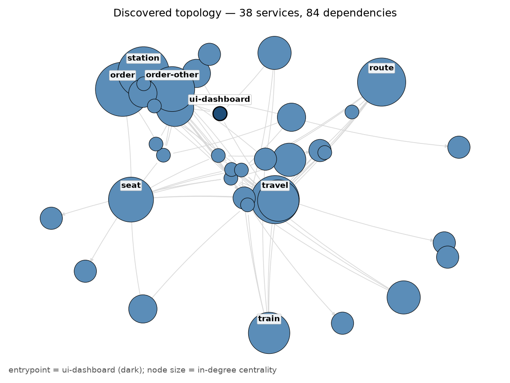
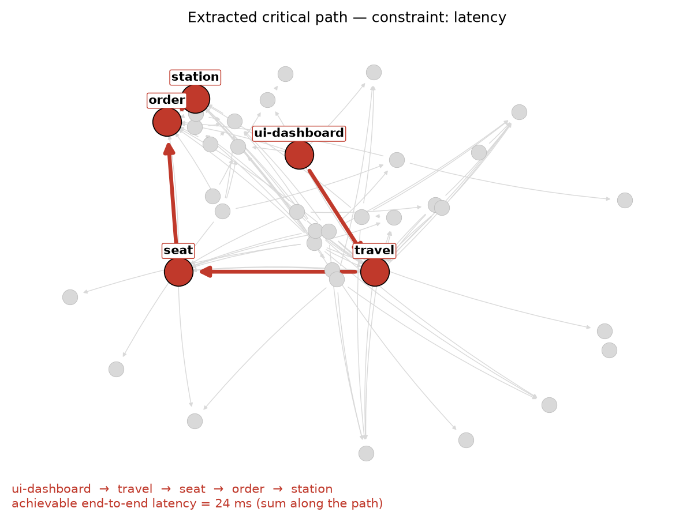
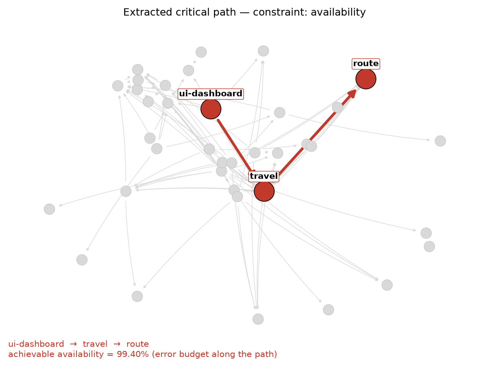

# slacheck — démo : de la topologie découverte au chemin critique extrait

Cette démo montre, sur le benchmark microservices **train-ticket** (38 services, découverts
automatiquement depuis Datadog), comment `slacheck` :

1. reconstruit le **graphe de dépendances complet** de l'application ;
2. en **extrait le sous-graphe (chemin critique)** qui répond à la contrainte SLA de l'architecte ;
3. calcule l'**enveloppe garantissable** le long de ce chemin.

Toutes les figures ci-dessous sont **générées depuis le vrai pipeline** (aucune n'est dessinée à la
main). Pour les régénérer :

```bash
python scripts/gen_demo_figures.py      # -> figures/demo/*.png
```

---

## 1. Le graphe de départ — topologie découverte

`slacheck` interroge la carte de services Datadog et reconstruit le graphe de dépendances typé.
Ici : **38 services, 84 dépendances**. La taille des nœuds encode la centralité (in-degree) ; le
point d'entrée choisi par l'utilisateur (`ts-ui-dashboard`) est en foncé.



On voit émerger les **hubs** structurels — `travel`, `order`, `station`, `route`, `seat` — qui sont
consommés par de nombreux autres services. Aucun de ces poids n'est saisi à la main : ils viennent
de la topologie observée.

---

## 2. Le sous-graphe extrait — chemin critique sous contrainte

À partir du graphe complet, `slacheck` extrait le **chemin critique** depuis le point d'entrée : la
chaîne qui domine la métrique visée. **Le sous-graphe extrait dépend de la contrainte** de
l'architecte — c'est le cœur de la démo.

### Contrainte : latence

Le chemin de latence maximale (celui qui dicte le temps de réponse bout-en-bout sous l'opérateur
MaxType) traverse 5 services :



```
ts-ui-dashboard → ts-travel → ts-seat → ts-order → ts-station
Enveloppe atteignable : latence bout-en-bout = 24 ms (somme le long du chemin)
```

### Contrainte : disponibilité

Pour la **même application**, mais sous une contrainte de disponibilité, le chemin critique est
**différent** — c'est celui qui consomme le plus de budget d'erreur :



```
ts-ui-dashboard → ts-travel → ts-route
Enveloppe atteignable : disponibilité = 99.40 % (budget d'erreur le long du chemin)
```

**Ce que la démo illustre :** le même graphe de départ produit deux sous-graphes distincts selon la
question posée. C'est ce qui permet à `slacheck` de répondre *« quel SLA puis-je garantir ? »* pour
une métrique donnée, plutôt que de raisonner sur une topologie figée.

> **Note (méthode complète).** Les figures ci-dessus montrent la **réduction en chemin critique**
> (baseline de la pratique antérieure). La méthode complète agrège sur **tout le DAG typé** plutôt
> que sur un seul chemin, ce qui récupère les services à forte centralité situés *hors* du chemin
> critique (p. ex. `ts-order`, `ts-station`, `ts-train`) — voir `issre_paper.tex` §V-B et la figure
> `figures/train_ticket_dag.pdf`.

---

## 3. Le verdict en direct (Datadog)

Le pipeline complet tourne en live sur le déploiement train-ticket : découverte de topologie,
récupération des latences de trace, calcul de l'enveloppe, et **publication d'un dashboard Datadog**
portant le verdict (chemin critique, enveloppe, fautes d'over-commitment, timeseries par service).

Reproduire le live (nécessite les credentials Datadog dans `.env` ; suppose que l'application
émet déjà du trafic tracé par APM) :

```bash
slacheck explore                                     # inventaire de ce que l'org expose
DD_ENV=devolab slacheck record  --out fixtures/datadog_live
DD_ENV=devolab slacheck analyze --source live -e ts-ui-dashboard -c latency \
    --service-prefix ts- --exclude-contains with-jaeger
DD_ENV=devolab slacheck publish --source live -e ts-ui-dashboard -c latency \
    --service-prefix ts- --exclude-contains with-jaeger
```

Runbook complet (scopes, prérequis de trafic) : `docs/live_unblock.md`.
